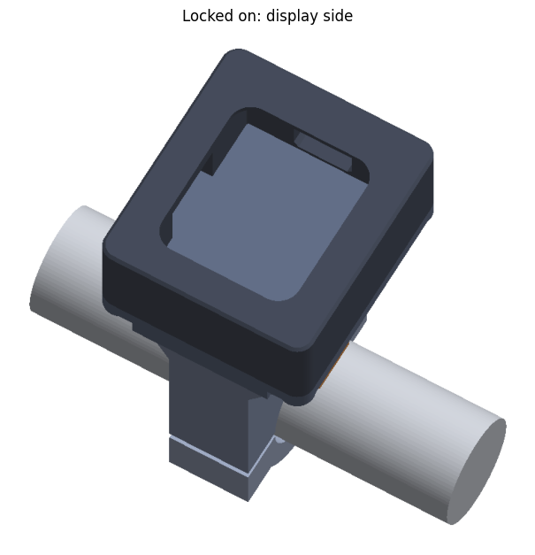
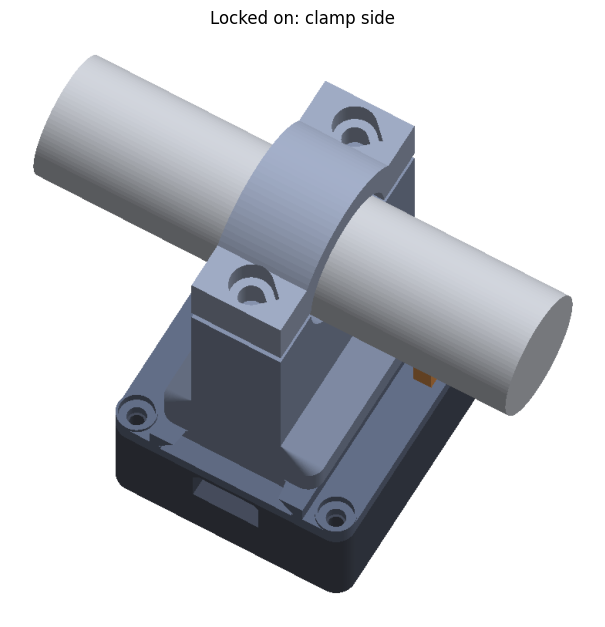
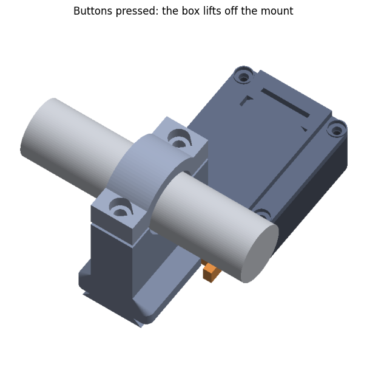

# MapMirror

This mirrors your phone's screen, such as your navigation app, to a small 240x280 ST7789 display on a motorcycle's handlebar. An ESP32 drives the display, and the phone sends frames over **Wi-Fi or Bluetooth LE**.

<p>
  
  
  
</p>

> **Ride safely, at your own risk.** Set the app up before you ride, and don't operate the phone or the display while riding. Check your local laws on mounting screens on a vehicle. The case is a hobby design that hasn't been tested on the road, so check it's secure before every ride. The software and designs come with no warranty: see [LICENSE](LICENSE).

```
Phone: MediaProjection → crop around the nav arrow → 240x280 → JPEG ──Wi-Fi TCP / BLE──► ESP32 → ST7789
```

- `android/` is the phone app (Kotlin, minSdk 26, targetSdk 35).
- `firmware/` is the ESP32 / ESP32-S3 firmware (PlatformIO, LovyanGFX, NimBLE).
- `case/` is a 3D printable handlebar case for the XIAO ESP32-C3 and display. See its [README](case/README.md).

## 1. Wire the display

| ST7789 pin | XIAO ESP32-C3 | ESP32-S3 | ESP32 (classic) |
|---|---|---|---|
| VCC | 3V3 | 3V3 | 3V3 |
| GND | GND | GND | GND |
| DIN (SDA / MOSI) | D10 (GPIO10) | 11 | 23 |
| CLK (SCL / SCK) | D8 (GPIO8) | 12 | 18 |
| CS | D1 (GPIO3) | 10 | 5 |
| DC | D2 (GPIO4) | 9 | 16 |
| RST | D3 (GPIO5) | 8 | 17 |
| BL | D4 (GPIO6) | 7 | 4 |

The numbers in the ESP32 columns are GPIOs. You can change the pins in `firmware/include/config.h`. For the XIAO in the handlebar case, see [Wiring the display to the XIAO](case/README.md#wiring-the-display-to-the-xiao), which shows which edge each pin is on and how the wires reach them.

## 2. Flash the firmware

1. Copy `firmware/include/secrets.h.example` to `secrets.h` in the same folder, and set `WIFI_STA_SSID`/`WIFI_STA_PASS` in it to your phone's hotspot. Git ignores `secrets.h`, so your password stays out of the repo. This is best in a car, because the phone keeps mobile data. You can also leave them blank. In that case the board starts its own AP, `MapMirror-XXXX`, at 192.168.4.1, with a random password that only goes to the paired phone.
2. Run `cd firmware && pio run -e xiao_c3 -t upload` (or `-e esp32s3`, `-e esp32`).
   - For the S3 env, `qio_opi` is the PSRAM setting for N8R8/N16R8 modules. Use `qio_qspi` for N4R2. If there's no PSRAM, remove `-DBOARD_HAS_PSRAM`.
3. The panel shows an info screen with the Wi-Fi network, IP and BLE status until the phone connects.

If the image is shifted by 20 px or shows a garbage strip, set `PANEL_OFFSET_Y` to 0. If the colours look like a negative, flip `PANEL_INVERT`.

## 3. Build the app

Open `android/` in Android Studio (Ladybug or newer) and press Run. Android Studio provides the Gradle wrapper. From the command line, run `gradle wrapper` once first.

## 4. Use it

1. Tap **Start mirroring**. The first time, pairing takes two codes:
   1. The panel shows a 6-digit code. Enter it in Android's pairing prompt.
   2. The panel then shows **Check code**, and the phone asks whether the display shows the same code, in the app or in a notification. Tap **Yes, it matches** only if it does. This stops another device from pretending to be your display.

   Both sides keep this pairing, so you only do it once.
   - **New phones can only pair** while the display has never been paired, or in the first 2 minutes after it's powered on. The info screen shows how long is left. After that, nobody nearby can pair with it.
   - **To pair a replacement display**, or after **Forget paired display**, restart the display, then tap Start within 2 minutes.
2. Allow screen capture. The app starts on BLE, gets the Wi-Fi details over the encrypted link, then moves frames to Wi-Fi by itself, and back to BLE if Wi-Fi drops. Android may ask you to approve the display's Wi-Fi the first time.
   - On Android 14+, you can choose **"A single app"** and pick your navigation app, so that only it is streamed. This needs the app to stay full screen: in picture-in-picture, a motorola edge 50 pro on Android 16 showed only the app's logo.
3. The first time, choose your navigation app from the list. It then opens automatically. Start navigation. **Navigation app** changes it later.
4. Tune the crop live with the sliders. The preview in the app is exactly what the panel shows.
   - If the display is **mounted upside down**, tick **Display mounted upside down**. The picture on the panel turns 180°, and the preview stays upright.
   - **Crop width**: lower values zoom in. 55–70% works well for navigation.
   - **Crop centre (from top)**: about 60–65% keeps the blue arrow in view during navigation.
   - **Crop centre (from left)**: leave at 50% for a full-screen app, or move it to aim at a window off to one side.

To show a picture-in-picture window, capture the **entire screen**, start navigation, press Home, then aim the crop at the window using the preview. The crop doesn't follow the window, so re-aim it if you move or resize the window.

### Virtual display mode (Android 13+)

This runs your navigation app on a private 480x560 display instead of capturing the phone's screen, so the phone stays free for other apps.

**Once:** turn on Developer options and Wireless debugging. In MapMirror, tap **Pair wireless debugging**, open **Pair device with pairing code** in the settings screen that opens, and type the code into MapMirror's notification.

**Once, from a computer:** this lets the app turn Wireless debugging on by itself, only while starting the display service:

```
adb shell pm grant dev.mapmirror android.permission.WRITE_SECURE_SETTINGS
```

It survives reboots and app updates, but has to be repeated if the app is uninstalled.

**Keep USB debugging on.** Joining the display's Wi-Fi turns off Wireless debugging, and the display service stops with it unless USB debugging is on.

**Wi-Fi at the motorcycle isn't needed.** The display service needs Wi-Fi to start, but once running it works anywhere until the phone restarts. It can't start on mobile data or on the display's own Wi-Fi, because Android turns Wireless debugging straight back off there. So MapMirror starts it while you're still on Wi-Fi:
- **With the permission above:** it starts by itself in the background, after a restart, the next time the phone is on Wi-Fi. Opening MapMirror on Wi-Fi also starts it. Nothing to remember.
- **Without it:** after each restart, tap **Start mirroring** once while on Wi-Fi, with Wireless debugging on, before you leave.

If you reach the motorcycle and it isn't running, MapMirror says so. Use **Screen capture** for that ride: it doesn't need the display service.

**To mirror:**
1. Start navigation on the phone. You can't tap the app on the phone once it's on the virtual display.
2. In MapMirror, choose **Virtual display** and tap **Start mirroring**. The navigation app moves to the virtual display, keeping its route.
3. Tap **Stop** to bring the app back to the phone.

The crop sliders are hidden in this mode, because the whole display is sent.

While mirroring, the preview in MapMirror is also a touch screen for the navigation app: tap, drag and pinch on it, and use **Back** for the back key. **Map text size** changes how large the app draws its text and buttons, live.

**Map colours** keeps the picture looking like day or night by flipping any frame that shows the opposite, which it judges from the frame's overall brightness. It's a filter, so colours are approximate. For true day or night maps, use your navigation app's own colour setting, if it has one.

The pairing key gives shell access to the phone, and stays in the app's private storage. The display service only listens on the phone itself, requires a secret token, and can only stream this display and send touches and Back to it. The adb connection is closed as soon as the service has started.

| | Wi-Fi | BLE |
|---|---|---|
| Typical rate | 10–15 fps | 3–6 fps |
| JPEG quality | Set with the slider | Capped at 45 |

The app caps quality and frame rate automatically while on BLE.

**Security:**
- **BLE** is encrypted and authenticated by the passkey pairing. New phones can only pair in the window above.
- **Each display has its own random key**, made on first boot and only given to phones paired with the passkey. The phone confirms it once with the check code, then checks it on every connection. A look-alike display can't get the map.
- **Wi-Fi frames** are encrypted and authenticated with that key (AES-128-GCM), on top of the display's WPA2 password. That holds even when the display joins an existing network: others on it can't see frames, send images or knock the phone off.

## Notes and limits

- The phone only sends frames when the screen changes. Identical frames are skipped and resent every 2 s. The display keeps the last frame for as long as a link exists.
- The app keeps the phone screen on (dimmed) while mirroring, because Android has nothing to capture once the screen is off. If you turn the screen off or lock the phone, the display keeps the last frame until you unlock it.
- Every app start asks for capture permission again. Android requires this.
- Frames are capped at 45 KB on the phone and 48 KB on the board. The app re-encodes at lower quality when a frame is too big.

## Protocol

**Key:** each display makes a random 32-byte key `K` on first boot. `HMAC(label | …)` below is HMAC-SHA256 keyed with `K`, with a 4-character label. Details are in `firmware/src/main.cpp`.
**Wi-Fi (TCP 5005):**
- The display sends `"MMS2" | nb(16)`. The phone answers `"MMC2" | np(16) | HMAC("MMTC" | nb | np)`, and the display replies `HMAC("MMTS" | nb | np)`. The session key is the first 16 bytes of `HMAC("MMTK" | nb | np)`.
- Frame: `"MMF2" | u32 LE length | AES-128-GCM(JPEG) | tag(16)`. The 8-byte header is the associated data, and the IV is 4 zero bytes then a u64 big-endian frame counter.
- The display replies with `0x06` after drawing, which gives flow control.
**Discovery (UDP 5006):** the display broadcasts `"MAPMIRROR 1"` once a second.
**BLE:**
- Service `4d4d0001-0000-4d61-7020-4d6972726f72`.
- Write-without-response characteristic `4d4d0002-…`, which needs a paired link.
- Read characteristic `4d4d0003-…`, which needs a paired link: `ssid \n password \n bssid \n ip \n hex(K)`.
- Key check characteristic `4d4d0004-…`, which needs a paired link. The phone writes `flags (bit0 show the check code) | nonce(16)`, then reads `HMAC("MMBP" | nonce)`. The check code is the first 4 bytes of `HMAC("MMCF" | nonce)`, big-endian, mod 1 000 000.
- Chunk format: `flags (bit0 START, bit1 END) | frameId | [u32 LE total, START only] | data`. Each chunk is at most 512 bytes, with MTU 517 and 2M PHY.

## Licence

MIT. See [LICENSE](LICENSE). The app and firmware use open source libraries under their own licences: see [THIRD_PARTY_NOTICES.md](THIRD_PARTY_NOTICES.md).

MapMirror isn't affiliated with or endorsed by the makers of any navigation app. It only shows what's on your own phone's screen.
