# MapMirror handlebar case

A sealed, screw-closed 3D printable box for the MapMirror display: a Seeed XIAO ESP32-C3 and a Waveshare 1.69" ST7789V2 module. It locks onto a handlebar mount with a two-button quick release, so you can print a mount for each vehicle and move the box between them.

| | |
|---|---|
| 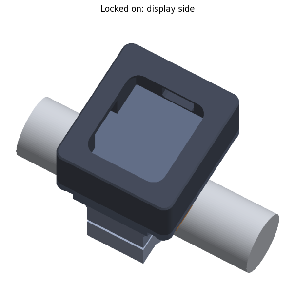 | 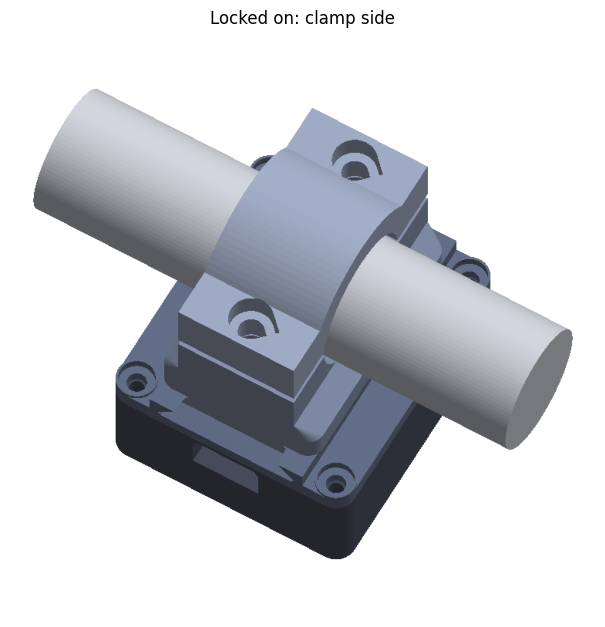 |
| Locked on: display side | Locked on: clamp side |
| 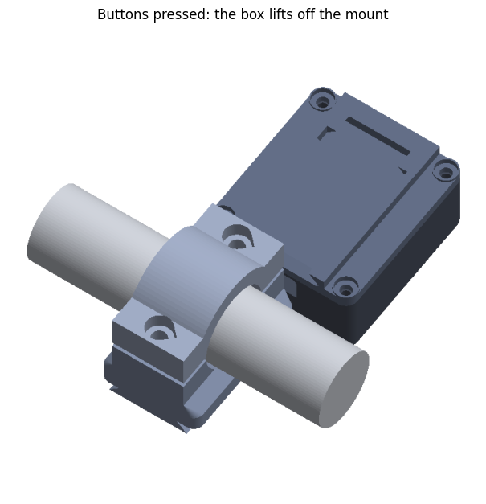 | 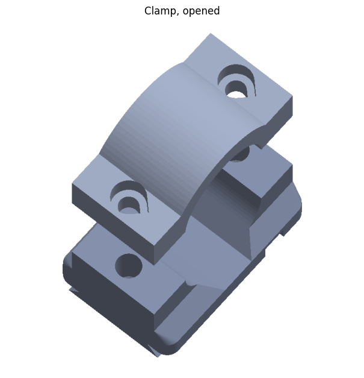 |
| Buttons pressed: the box lifts off the mount | The clamp, opened |
| 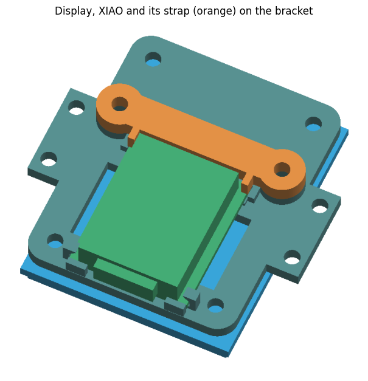 | 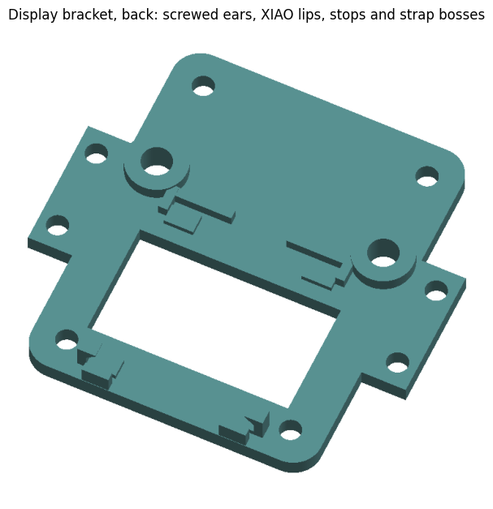 |
| The display, XIAO and its strap (orange) on the bracket | The bracket's back: ears, XIAO lips, stops and strap bosses |
| 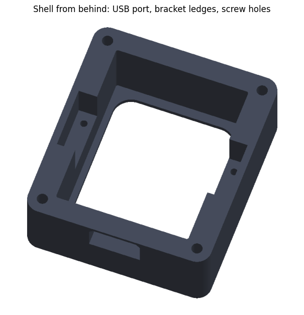 | 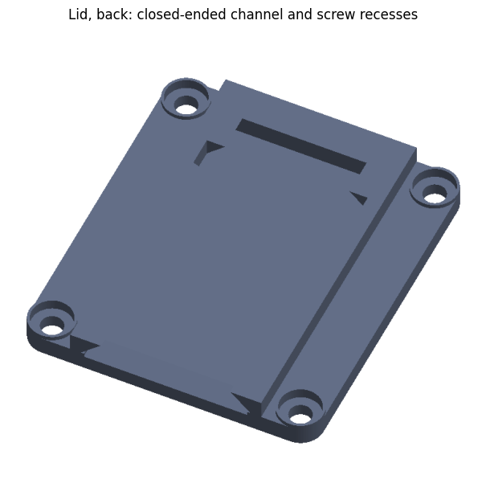 |
| The shell from behind: USB port, bracket ledges and screw holes | The lid's back: closed-ended channel and screw recesses |
| 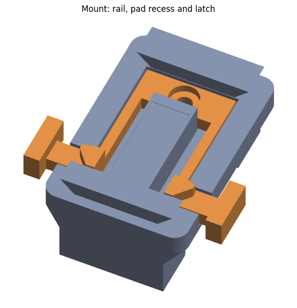 | 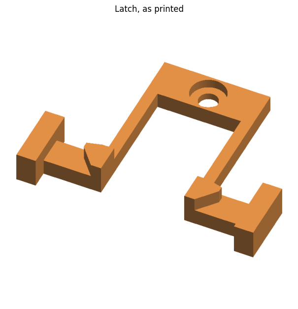 |
| The mount: rail, pad recess and latch | The latch, as printed |

Sections through the assembly, and through the latch:

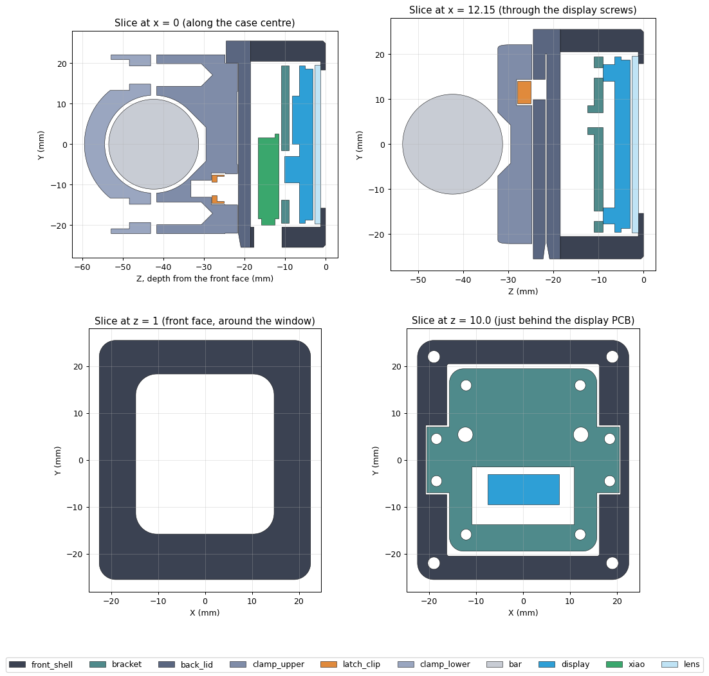

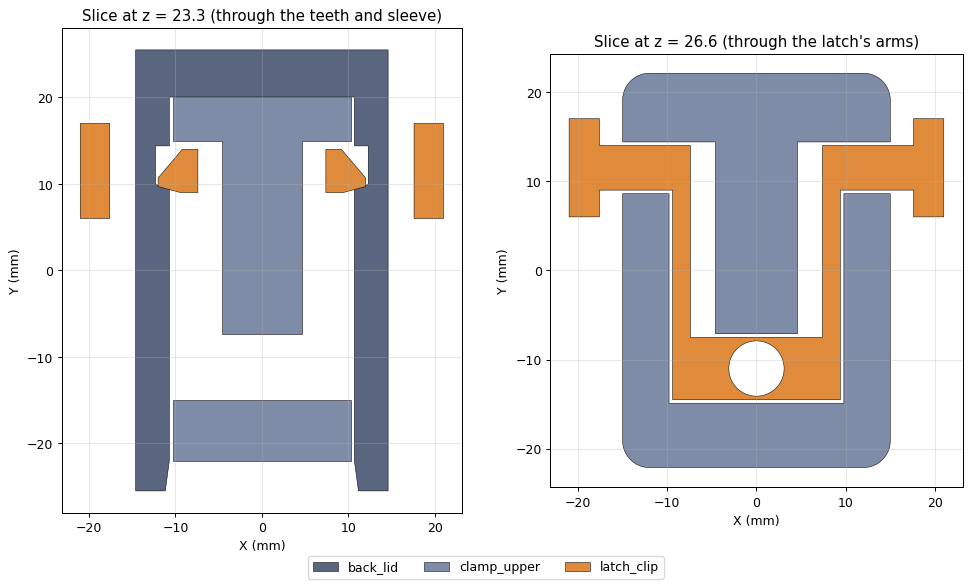

These are renders of the model from `build.py`, which regenerates them on every build.

| | Size |
|---|---|
| Box, off the mount | 45 × 51 × 24.5 mm |
| Box on the mount, display to back of clamp | 59.5 mm deep |

**This design hasn't been printed yet.** Fit, latch travel and overhangs have only been checked in the model, and the strength figures are estimates. Print the fit tests first, and test the latch and clamp on the bike before riding.

## How it goes together

| Joint | How | Why |
|---|---|---|
| Lid to shell | 4 M3 screws, tapping their own threads into blind holes in the corners | No screw hole opens into the box, and the seal can be redone |
| Box to mount | Dovetail, locked by a two-button latch | Slide down until it clicks. Squeeze both buttons to slide it off |
| Latch to mount | 1 M3 screw | Only holds it in place while the box is off. Pulling forces go into the mount's plastic |
| Mount to handlebar | 2 M4 bolts | **Deliberately not snap-fit.** Losing the case at speed is dangerous |
| Display to bracket | 4 M2 screws | Into the display's own brass standoffs |
| Bracket to shell | 4 M2 screws, tapping their own threads into the ledges | The bracket drops in loosely, with 0.5 mm clearance around the display. Its two ears rest on ledges in the side walls and are screwed down onto them |
| XIAO to bracket | 2 M2 screws, into heat-set inserts | The USB end tucks under two lips against an end stop. A printed strap screws down over the far end, and its two tabs clamp the board's corners |

Nothing inside the box relies on adhesive, foam or a snap, so vibration can't work anything loose.

The box has one opening: **the USB-C port**, which it needs for power. The lid, sides and back are otherwise solid.

### Using the quick release

- **To fit:** line the box's channel up with the mount's rail, then slide the box straight down until both buttons click. Plug in the USB-C cable.
- **To remove:** unplug the cable, squeeze both buttons together, and slide the box up.

Pressing one button alone doesn't release it. The buttons sit just inside the box's edges, so a knock from the side is less likely to reach them.

### Why it shouldn't rattle

- A rubber pad on the rail pushes the box away from the mount, which draws the dovetail's 45 degree faces tightly together. That removes the play both across and away from the mount, and it allows for printer error.
- The closed end of the channel stops the box going down. The teeth's catches slope by 15 degrees, so their spring pulls the box firmly against that stop.

## Before printing

The display's sizes come from [Waveshare's 2D drawing](https://files.waveshare.com/upload/4/41/1.69inch_LCD_Module_2Ddrawing.pdf). Change anything that differs at the top of `build.py`:

| Setting | Default | What to check |
|---|---|---|
| `BAR_D` | 22.2 mm | Handlebar diameter on **each vehicle**. Common sizes are 22.2, 25.4 and 28.6 mm. Build a mount for each size |
| `MOUNT_RISE` | 0 mm | **On clip-on bars**, where the switch block or lever sits right beside the clamp. Measure how far the highest of them stands above the top of the bar, and set this to that minus 1.8 mm, plus 3 mm of margin. The upper mount then gets a neck as narrow as the clamp, and the plate and box sit above them |
| `PLUG_W`, `PLUG_H` | 12.5 × 6.9 mm | **Measure the moulded body of your USB-C plug.** It has to reach about 6 mm into the port for the plug to seat |
| `M3_INSERT_D`, `M4_INSERT_D` | 4.2, 5.6 mm | Hole sizes for the mount's heat-set inserts. Check the seller's figures |
| `M3_PILOT_D`, `M2_PILOT_D` | 2.6, 1.7 mm | Pilot holes the shell's screws tap into. If a screw is very hard to drive, add 0.1 mm. If it strips, take 0.1 mm off |
| `USB_OVERHANG` | 1.5 mm | **Estimate.** How far the XIAO's USB socket sticks out past its board |
| `STANDOFF_OD` | 3.6 mm | **Estimate.** Outside diameter of the display's brass standoffs |
| `GLASS_T` | 1.9 mm | **Estimate.** Thickness of the glass and backlight, in front of the PCB |

Bars larger than 22.2 mm make the clamp bigger, and the checks in the build will flag any collisions.

To rebuild, from this folder:

```
python -m venv .venv
.venv\Scripts\python -m pip install -r requirements.txt
.venv\Scripts\python build.py
```

The build exports the STL files to `stl/` and renders to `preview/`. It exits with an error if a check fails. These include sliding the box the whole way off the mount, with the latch pressed.

## Printing

Use **PETG or ASA**. PLA can soften in the sun, and it's too brittle for the latch. The files are already oriented for printing, and **orientation matters**: turning a part over brings back overhangs.

**Turn supports off for every part.** `build.py` slices each part at 0.2 mm and fails if a layer has nothing to rest on, apart from the two short bridges below.

### The box: print one

| File | Printed | Bridge, if any |
|---|---|---|
| `front_shell.stl` | Face down, so the front takes the bed's finish | USB port's roof, about 10 mm across |
| `box_lid.stl` | Inner face down, which gives a flat sealing face | None |
| `display_bracket.stl` | Front side down | None |
| `xiao_strap.stl` | Flat | None |

### The mount: print one set per vehicle

| File | Printed | Bridge, if any |
|---|---|---|
| `mount_upper.stl` | The clamp's flat faces down, rail up | Flat above the bar, about 8 mm across, hidden by the bar |
| `mount_lower.stl` | On its side, so its layers run around the bar | None |
| `latch.stl` | Flat, buttons and teeth up | None |

### Fit tests: print these first

| File | What to check |
|---|---|
| `fit_test_front.stl` | The window lines up with the picture, and the display fits |
| `fit_test_bracket.stl` | The bracket's ears drop into their slots freely, and the ear and lid screw holes line up |
| `fit_test_mount.stl` | With `latch.stl` and `box_lid.stl`: the box slides on and clicks, and both buttons release it. It's the full mount's plate and rail, without the clamp |

Suggested settings: 0.2 mm layers, 4 or more walls, and 40% or more infill. For the mount parts, use 6 walls. Print `latch.stl` with solid infill.

The 45 degree slopes behind the mount's plate will show some layer steps. They face away from you, and they're what removes the need for support.

### Tuning the fit

Change one setting at a time, by 0.1 mm, and print `fit_test_mount.stl` again:

| Problem | Setting | Change |
|---|---|---|
| Box slides on too stiffly, or latch won't drop into its pocket | `QR_FIT` (0.4 mm, which also sets `RAIL_CLEAR`) | Increase |
| Box rattles | `PAD_PROUD`, or a thicker pad | Increase |
| Box won't click, or sits loose against the catch | `PRELOAD` | Decrease if it won't click, increase if it's loose |
| Buttons too stiff | `LATCH_ARM_X0` | Increase, making the arms thinner |
| Display or bracket won't drop in | `CAVITY_FIT` | Increase |
| Bracket's ears tight in their slots | `EAR_CLEAR`, `EAR_TIP_CLEAR` | Increase |
| XIAO still moves with the strap screwed down | `STRAP_PRELOAD` | Increase |

The build fails if a change stops a part from fitting.

## Parts to buy

### The box: one set

| Qty | Part | Used for |
|---|---|---|
| 4 | M3 x 10 button head screw | Lid to shell, tapping into the corners |
| 4 | M2 x 4 screw, head under 4 mm wide | Display to bracket |
| 4 | M2 x 8 screw, head under 4 mm wide | Bracket to shell, tapping into the ledges |
| 2 | M2 x 6 screw, head under 4 mm wide | The XIAO's strap |
| 2 | M2 x 3 heat-set insert, about 3.2 mm hole | The bracket's strap bosses |
| 1 | Medium-strength threadlocker, safe for plastics | A small drop on each M2 screw into the bracket or shell |
| 1 | 31.8 × 39.3 × 1.5 mm clear acrylic or polycarbonate | Window, fitted from inside. No thicker than 1.5 mm, or it reaches the display |
| 1 | Neutral-cure silicone | Seals the window, lid, screws and USB socket |

### The mount: one set per vehicle

| Qty | Part | Used for |
|---|---|---|
| 2 | M4 x 16 cap screw | Clamp |
| 2 | M4 x 8.1 heat-set insert, about 5.6 mm hole | Upper mount |
| 1 | M3 x 6 button head screw | Latch |
| 1 | M3 x 4 heat-set insert, about 4.2 mm hole | Latch |
| 1 | Rubber strip, about 1 mm thick and 22 mm wide | Between the clamp and bar |
| 1 | 8 × 18 mm self-adhesive rubber, 1 mm thick | Pad on the rail, which stops rattle |
| 1 | Medium-strength threadlocker, such as blue Loctite 243 | M4 bolts and the latch screw |
| 1 | 12 V to 5 V USB converter, fused | Power from the bike |
| 1 | USB-C cable with a slim plug | Power, and reflashing |

Your waterproofing product is separate, and is covered below.

## Wiring the display to the XIAO

| Display pin | XIAO pin | Edge of the XIAO (see below) | Pin from the USB end |
|---|---|---|---|
| VCC | 3V3 | Left | 3rd |
| GND | GND | Left | 2nd |
| DIN | D10 | Left | 4th |
| CLK | D8 | Left | 6th |
| CS | D1 | Right | 2nd |
| DC | D2 | Right | 3rd |
| RST | D3 | Right | 4th |
| BL | D4 | Right | 5th |

"Left" and "right" are as seen from the bracket's back, with the XIAO's metal shield facing you and its USB socket pointing down, which is how it sits in the box. Check the pins against Seeed's XIAO ESP32-C3 pinout before soldering. The display also takes 5 V, but use 3V3, which matches the XIAO's signal levels.

These pins all lie beside the bracket's opening, which reaches 2 mm past each long edge of the XIAO. The wires come up through it, either side of the board, to the pins. The other pins, 5V, D0, D5, D6, D7 and D9, aren't used.

- **The XIAO must have no pin headers.** The board lies flat on the bracket, with no room for headers under it.
- **Solder the wires before fitting the XIAO.** Nothing on the bracket passes over the pins the wires use while the board goes in. Keep each joint within about 1 mm of the board's edge, and lead the wire straight down from it.
- **Use the display's own cable.** Cut off the connectors on its far end, leaving about 5 cm of wire. Strip about 2 mm of each wire and tin it.
- **Keep the heat brief.** The bracket is plastic, right next to the pins. Tin the pad, then hold each wire on it with the iron for no more than 2 to 3 seconds.

To take the XIAO off later, remove its strap, lift its far end and slide it out from under the lips.

## Assembling the box

1. Press the two M2 inserts into the round bosses on the bracket's back, from the back. Let them cool. Keep the iron straight, so each insert goes in square.
   - The shell has no inserts. Cut the threads in its holes now, before anything is fitted: drive each M3 x 10 into a corner hole and each M2 x 8 into a ledge hole, straight and slowly, all the way, then back it out. At assembly, the screws then follow these threads instead of cutting new ones. Print the shell with at least 4 walls, so the screws cut into solid plastic.
2. Drop the window into the shell from the back, so it sits flat against the inside of the front face. Run a continuous bead of silicone around its edge, from inside, keeping it off the window's visible area and the ledge slots. Let it cure. It can't fall out of the front, even if the silicone fails.
3. Screw the display to the bracket's front with the M2 screws, gently, as the threads are small brass ones.
4. Solder the display's cable to the XIAO, as in [Wiring the display to the XIAO](#wiring-the-display-to-the-xiao), and plug it into the display through the bracket's opening.
5. Fit the XIAO to the bracket's back, with its USB socket towards the ribbon end, and the wires going down into the opening on each side of it:
   1. Hold its far end raised slightly, and slide the USB end under the two small lips until it touches the end stop. It only moves about 2.5 mm.
   2. Lower the far end, between the two posts.
   3. Check no wire is trapped under the board.
   4. Lay the strap across the far end, with its two tabs over the board's corners, and fit its two M2 x 6 screws with threadlocker. Tighten them until the strap sits down on its bosses and the board can't move. Don't overtighten into the inserts.
6. Fix the XIAO's antenna to the bracket, away from the screws. A small cable tie through the bracket's opening is better than tape, which vibration can peel off.
7. Flash the firmware, if you haven't already, then power it up and check it works.
8. Apply your waterproofing, as covered below, and let it cure.
9. Lower the bracket into the shell, display first, with the USB socket towards the port, so its two ears drop into the slots in the side walls. It should go in freely and rest on the ledges. Don't press it in. Fit the four M2 x 8 screws through the ears, with threadlocker, and tighten them evenly. Stop as soon as they're snug, as the threads are in plastic and strip if forced.
10. Run a thin, unbroken bead of silicone around the shell's rim, inside the screw holes. Put the lid on, then fit the four screws, with a dab of silicone under each head. Tighten them evenly, until the lid sits down on the rim. Don't overtighten, or the bead squeezes out and the plastic threads strip.
11. Seal the gap around the USB socket, through the port, with a thin bead of silicone. Keep it out of the socket itself, and out of the plug's path. Let it cure.

If the picture appears upside down, tick **Display mounted upside down** in the app.

To open the box, take out the four screws and cut the silicone. Use a new bead when you close it.

## Assembling a mount

1. Press the two M4 inserts into the holes in the upper mount's flat faces, and the M3 insert into the hole in the latch's pocket. Let them cool.
2. Drop the latch into its pocket, with its teeth facing out of the pocket, and fit its screw with threadlocker. Check both buttons spring back freely.
3. Stick the rubber pad in the shallow recess on the rail.
4. Wrap the 22 mm rubber around the bar and fit the lower clamp half. Fit the M4 bolts with threadlocker.
5. Rotate the mount to the viewing angle you want, keeping the rail's closed end at the top, so the box slides downwards to fit. Tighten both bolts evenly. Keep the gap between the halves about the same on each side. Don't close it completely, as that means the clamp no longer grips.
6. Route the cable as below, so it stays on the bike when the box comes off.

### Power

Use a fused 5 V supply, switched with the ignition. Tie the cable to the bar near the mount, so vibration and tugs don't strain the XIAO's socket, and leave a drip loop below the port so water runs off before reaching it.

## Waterproofing

The USB-C port is the weakest point. The socket isn't waterproof, and you'll be unplugging the cable, so the plug can no longer be sealed in with silicone. The silicone around the socket keeps water out of the box, but water can still reach the socket's contacts. **Fit a rubber USB-C plug when the box is off the bike and out of the weather**, and treat the mounted box as splash-resistant rather than waterproof.

| Product | Suitability | Notes |
|---|---|---|
| **Conformal coating** on the boards | Best choice | Thin, so it needs no extra space. Mask the display's connector, the XIAO's USB socket and antenna connector, and don't let it reach the glass |
| **Silicone or resin potting** | Not recommended | See the warnings below |
| **Desiccant** | Good addition | A small sachet absorbs moisture from sealed-in air, if you can fit one |

**Potting doesn't suit this box well.** There's very little space inside, and:
- Liquid can run around the display and into the 0.4 mm gap in front of the glass, permanently marking the screen. It can also get inside the display itself.
- It can seize the USB socket.
- It traps heat in a sealed box in the sun.
- It can weaken the Wi-Fi and BLE range if it reaches the antenna.

Test the sealed box with water before riding, and check inside for moisture afterwards. It isn't rated for pressure washing.

## Safety checks before riding

- Turn the steering lock to lock in both directions, and make sure the box and cable never touch the tank, fairing, controls or brake lines. Check that the cable doesn't pull at full lock either.
- Mount it so it doesn't block your gauges, your controls or your view of the road.
- With the box locked on, pull it hard upwards and away from the mount, then try to rotate the mount on the bar. Nothing should move.
- Check the mount's bolts after your first short ride, and regularly after that. Plastic can relax over time.
- Check the latch's teeth and arms, and the lid's catches, for cracks. Replace a cracked latch before riding: it's a small print. A cracked lid or mount also needs replacing.
- Keep the channel clear. Grit can wear the dovetail and stop the box locking fully, so check that both buttons click every time.
- Don't take your eyes off the road to use it, and follow local rules on handlebar-mounted screens.

The two teeth are all that stop the box sliding up off the mount. There's no backup, so don't ride if the box moves on the rail or only one button clicks. A short tether between the box and bike would add a backup if you want one, but there's no anchor point for it in this design.

## Design notes

- **Tilt:** you set the angle by rotating the mount on the bar. There's no separate pivot, so there's less to work loose.
- **Screen:** the bracket's position keeps the glass 0.4 mm behind the window. The picture is off-centre on Waveshare's board, so the window is too.
- **Box width:** the box is about 13 mm wider and 12 mm taller than the display. The M3 screws have to sit outside the display's corners, and the side walls hold the ledges that the bracket screws into.
- **Latch:** it's a separate part because arms built into the mount would hang in the air while printing. It also means wear is limited to a small part that's quick to reprint, rather than the box.
- **Water in the channel:** the channel's open end points down, so water can drain out.
- **Clamp bolts:** heat-set inserts replace nuts, so the clamp's sides have no slots. The holes end in cones, and the lower clamp's holes have pointed tops, so neither needs support.
- **Bar grip:** the clamp's upper half grips the bar on two sloped sides, with a small gap at the top. That gap is what lets it print without support.
- **Depth:** the box's depth comes from stacking the display, its connector and the XIAO behind each other. The quick release adds about 5 mm over a fixed mount.
- **Heat:** the box is sealed with no vents. If the display dims or the board resets in hot sun, a lighter colour helps.
- **Screen glare:** there's no sun visor, and ST7789 panels can be hard to read in direct sun.
